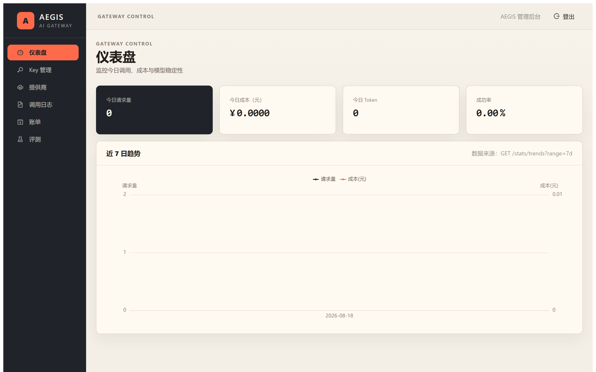
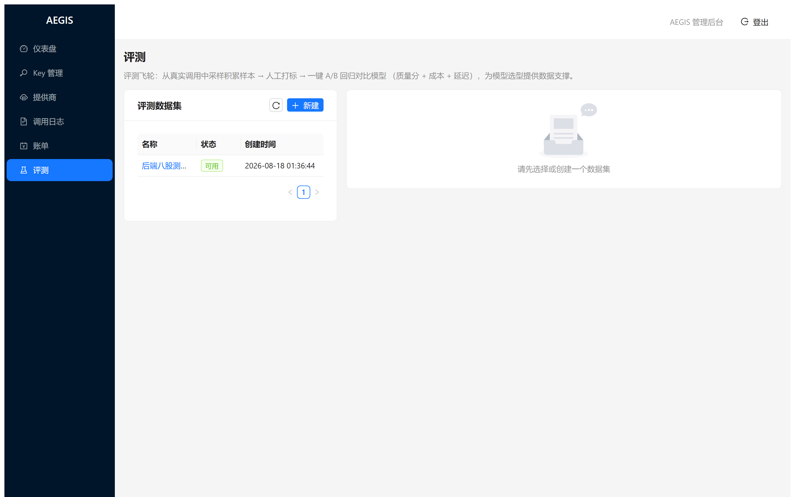
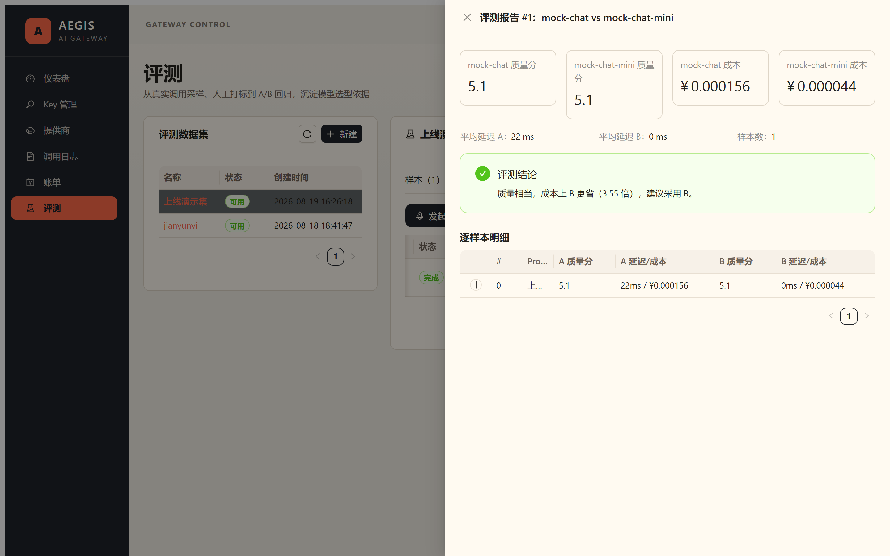
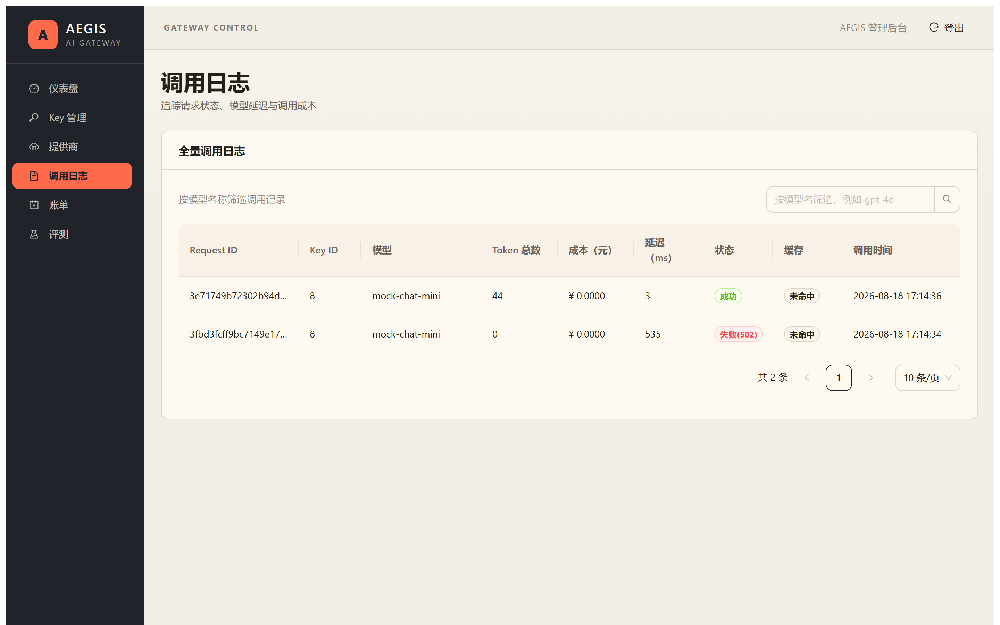

# AEGIS — Enterprise LLM Gateway & Intelligence Platform

> **AEGIS** — An Enterprise LLM Gateway & Intelligence Platform: unified access, routing, rate-limiting, billing, observability, and model evaluation for multiple LLM providers.

[](https://opensource.org/licenses/MIT)
[](https://go.dev/)
[](https://nextjs.org/)
[](https://github.com/jianyunyi/aegis-gateway/actions/workflows/ci.yml)
[](https://docs.docker.com/compose/)

> A unified gateway for enterprise LLM access — the **infrastructure layer** of AI. Teams plug AEGIS in front of multiple model providers (OpenAI, DeepSeek, Qwen, Ollama, ...) to get unified auth, cost control, observability, and evaluation.
> Tech stack: Go + Gin + Gorm + Redis + MySQL ｜ Next.js + React + TypeScript ｜ Docker

📖 [中文文档 (Chinese README)](README.md)

## Table of Contents
- [Features](#features)
- [Screenshots](#screenshots)
- [Architecture](#architecture)
- [Project Structure](#project-structure)
- [Contributing](#contributing)
- [License](#license)

## Quick Start

```bash
# 1. Generate local random secrets and a one-time admin password
./scripts/init-compose-env.sh

# 2. Build the Go binaries, then start MySQL + Redis + SQL migration + Gateway + mock + Admin UI
make build-linux
docker compose -f deploy/docker-compose.yml up -d --build

# 3. Health check
curl http://localhost:8081/healthz
curl http://localhost:8081/readyz

# 4. Open the Admin UI; username is admin, password is printed once by the setup script
open http://localhost:3000
```

> All host ports bind to `127.0.0.1`: Gateway `8081`, Admin UI `3000`, MySQL `3303`, Redis `6380`, mock sandbox `8099`. Put a trusted HTTPS reverse proxy in front before exposing any service publicly; do not publish the Compose HTTP ports directly.
> Building the web image requires network access (`npm ci`, uses npmmirror registry); offline? Run the UI locally with `npm run dev`.

Local development (without Docker):

```bash
./scripts/init-compose-env.sh                                    # once, if .env does not exist
docker compose -f deploy/docker-compose.yml up -d mysql redis    # dependencies only
set -a && . ./.env && set +a
export APP_ENV=dev AUTO_MIGRATE=true
export MYSQL_DSN="${MYSQL_USER}:${MYSQL_PASSWORD}@tcp(127.0.0.1:3303)/aegis?charset=utf8mb4&parseTime=True&loc=Local"
export REDIS_ADDR=127.0.0.1:6380
(cd backend && go run ./cmd/gateway)                                # gateway on :8081
(cd web && npm install && npm run dev)                              # admin UI on :3000
```

## Features

| Capability | Description |
|---|---|
| Unified access | OpenAI-compatible protocol — any official SDK works by changing `base_url`; SSE streaming with byte-level forwarding and TTFT (time-to-first-token) recording |
| Security & auth | API keys stored as SHA-256 hashes (plaintext shown once at creation); provider keys AES-256-GCM encrypted; JWT-protected admin API |
| Rate limiting | Redis Lua token bucket, admin login throttling, request body limit, and atomic API-key quota reservations |
| Billing & reconciliation | Usage parsing, pricing, and ledger entries for chat/completions, completions, and embeddings; periodic Redis/MySQL reconciliation |
| Observability | Dashboard (requests/cost/tokens/success rate/latency), 7/30-day trends, paginated log queries, daily billing |
| Cost optimization | Semantic routing (Header > key default model > heuristics); request caching (composite key includes routed model); monthly budget auto-downgrade with alerts |
| Privacy & evaluation | Prompt capture is off by default; optional redacted sampling, per-request opt-out, and retention cleanup; manual samples remain available for A/B evaluation |
| Admin UI | Next.js + Ant Design: login / dashboard / keys / providers / models / logs / billing / evals |

## Screenshots

| Admin Dashboard | Evals · Samples |
|---|---|
|  |  |

| Evals · A/B Report | Call Logs |
|---|---|
|  |  |

> Screenshots are generated by `scripts/screenshot.mjs` (Playwright headless browser, see script comments).

## Architecture

```
Clients (OpenAI SDK / curl) ──Bearer ak_xxx──► AEGIS Gateway (Go/Gin)
   Middleware chain: KeyAuth → RateLimit → Semantic Routing → Request Cache → Budget Downgrade → Streaming Proxy
        │                                       │
   Redis(rate-limit/cache/quota + budget reservations)    MySQL(keys/models/usage ledger/billing/evals; monthly budget authority)
        │
   Upstreams: OpenAI / DeepSeek / Qwen / Ollama / mock sandbox (unified OpenAI-compatible protocol)
```

Core design decisions (ADRs) and the database schema: see [docs/03-技术方案设计.md](docs/03-技术方案设计.md).

## Project Structure

```
aegis-gateway/
├── docs/          # All project docs (charter/PRD/TDD/standards/tests/interview notes)
├── backend/       # Go gateway (cmd / internal / migrations)
│   └── internal/  # config / handler / middleware / proxy / routing / service / repository / model
├── web/           # Next.js admin UI (App Router + Ant Design)
├── deploy/        # docker-compose / Dockerfiles
└── .github/       # GitHub Actions CI
```

## Contributing

Issues and PRs are welcome. Please read [CONTRIBUTING.md](CONTRIBUTING.md) first.

## License

[MIT](LICENSE) © 2026 jianyunyi
